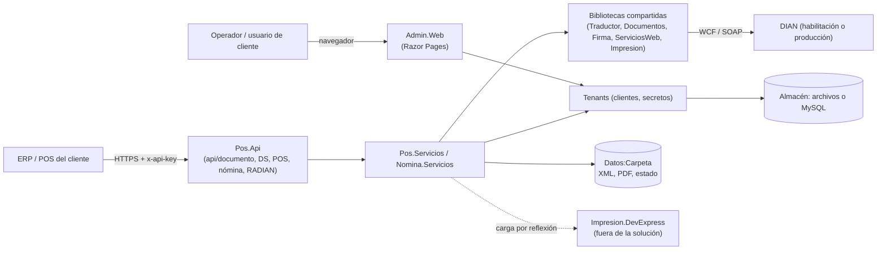

# Arquitectura

Última revisión: 2026-11-16

Visión técnica de `DIAN.Unificado`: una solución .NET 10 con una API multiempresa (`Pos.Api`), una app web de administración (`Admin.Web`) y bibliotecas compartidas. Para el porqué de las decisiones, ver el plan en `DIAN\docs\plan-unificacion-api.md` (documento del repositorio raíz DIAN).

## 1. Piezas y capas

Capas, de arriba hacia abajo: controladores delgados (`Pos.Api`) → servicios de negocio (`Pos.Servicios`, `Nomina.Servicios`) → bibliotecas compartidas (`src/Shared`) → acceso a datos y secretos (`Tenants`). La API y la app Admin **no se llaman entre sí**: se comunican compartiendo el almacén de clientes y las llaves de cifrado (sección 5).

## 2. Proyectos

Todos usan `net10.0` (ver `Directory.Build.props`: `Nullable` y `ImplicitUsings` desactivados por defecto; algunos proyectos nuevos activan `Nullable`).

### En la solución (`DIAN.Unificado.sln`)

| Proyecto | Ruta | Responsabilidad |
|---|---|---|
| `Pos.Api` | `src/Pos/Pos.Api` | API HTTP (ASP.NET Core). Controladores, `TenantMiddleware` (clave de API → cliente), `ReintentosWorker`, `/salud`, carga del generador de PDF. |
| `Pos.Servicios` | `src/Pos/Pos.Servicios` | Lógica de documentos: `DocumentoServicio` (factura, notas), `DocumentoSoporteServicio`, `DocumentoEquivalenteServicio`, `NotaAjustePos`, `EnviadorDian`/`IFabricaEnviadorDian`, almacén de documentos, webhook. |
| `Nomina.Servicios` | `src/Nomina/Nomina.Servicios` | Nómina individual, ajuste y eventos RADIAN (`NominaServicio`, `EventosRadianServicio`, `ConstructorNomina`). |
| `MetaDatosNE` | `src/Nomina/MetaDatosNE` | Modelo del cuerpo de nómina (`MetaDatosNEI`), portado sin cambiar espacios de nombres. |
| `Admin.Web` | `src/Admin/Admin.Web` | App Razor Pages: clientes, usuarios del portal, auditoría. Ver [seguridad.md](seguridad.md). |
| `Tenants` | `src/Shared/Tenants` | Clientes (tenants): `TenantConfig`, `ClienteRegistro`, almacenes (`FileTenantStore`, `MySqlTenantStore`), `ProtectorSecretos`, `ClaveApi`, `CertificadoCache`, `ClienteAdminServicio`, `Auditoria`, perfil de impresión. |
| `Traductor` | `src/Shared/Traductor` | `TraductorFactura` y `TraductorNota`: `DocumentoDian` (JSON del ERP) → tipos UBL. |
| `ModeloDian` | `src/Shared/ModeloDian` | Copia del modelo `DocumentoDian` y su constructor; ensamblado `DianModelDoc` (mismo contrato JSON que el ERP ya envía). |
| `Documentos` | `src/Shared/Documentos` | Generadores de XML UBL (`GeneradorFactura`, `GeneradorNotaCredito`, `GeneradorNotaDebito`, documento soporte, equivalente POS, nómina, eventos…). Ensamblado `eFacturacionColombia_NETCore.Documentos`. |
| `Tipos` | `src/Shared/Tipos` | Tipos UBL/DIAN generados. |
| `Metadatos` | `src/Shared/Metadatos` | Modelos de entrada para los generadores (`FacturacionColombia_Metadatos`). |
| `Firma` / `FirmaXades` / `Microsoft.Xades` | `src/Shared/…` | Firma XAdES con el certificado del cliente. |
| `ServiciosWeb` | `src/Shared/ServiciosWeb` | Cliente WCF/SOAP de la DIAN (`ClienteServicioDian`, `AmbienteServicio`, `RespuestaDian`). Usa la DLL propia de `libs/WCF`. |
| `Util` | `src/Shared/Util` | Utilidades (hora de Colombia, zip, XML, criptografía). |
| `Impresion` | `src/Shared/Impresion` | Sin dependencias: `LectorDocumentoAprobado`, modelo `DocumentoImpresion`, `IGeneradorPdf`, `DocumentoNoAprobadoException`. |
| Pruebas | `tests/*` | Ver [pruebas.md](pruebas.md). |

### Fuera de la solución (necesitan DevExpress 24.1 instalado)

| Proyecto | Ruta | Responsabilidad |
|---|---|---|
| `Impresion.DevExpress` | `src/Shared/Impresion.DevExpress` | `GeneradorPdfDevExpress` (implementa `IGeneradorPdf`) y `RenderizadorPdf`. |
| `GeneradorReportes` | `tools/Reportes/GeneradorReportes` | Genera la plantilla `.repx` a partir de la de QuantyERP. Ver [plantillas-pdf.md](plantillas-pdf.md). |
| `PruebaLinux` | `tools/Reportes/PruebaLinux` | Prueba de la cadena completa XML aprobado → PDF. |

## 3. Un documento de punta a punta (factura, nota crédito, nota débito)

Ruta: `POST api/documento/agregar` (`DocumentoController`). Código principal: `DocumentoServicio` en `Pos.Servicios/Documentos`.

1. **Autenticación y cliente.** `TenantMiddleware` lee la cabecera `x-api-key`, busca el cliente por el **hash** de la clave (`ITenantConfigProvider.BuscarPorClaveAsync`) y lo deja en `HttpContext.Items["DIAN.Tenant"]`. Sin clave, o clave desconocida o de cliente inactivo → 401. Solo `/salud` es pública.
2. **Lectura.** El controlador lee el cuerpo con `JObject.Parse(...).ToObject<DocumentoDian>()` (igual que la API anterior: es el contrato de QuantyERP). JSON inválido → 400.
3. **Validación y traducción** (`DocumentoServicio.Agregar`, síncrono):
   - el cliente debe tener software de tipo `FacturacionElectronica`; el documento debe traer `Numero`;
   - **idempotencia por número:** si ya existe y no está `Rechazado` ni `Error`, se devuelve el existente sin tocar la DIAN;
   - `TipoDocDian` `01` → `TraductorFactura.Factura`, `91` → `TraductorNota.NotaCredito`, `92` → `TraductorNota.NotaDebito`; otro valor → `DocumentoNoTraducibleException` (400). El traductor usa los generadores de `Documentos`; el CUFE sale del `UUID` del documento;
   - **firma XAdES** con el certificado del cliente (`CertificadoCache.Obtener` → `FirmaElectronica`);
   - se guarda el XML firmado y un `DocumentoRegistro` en estado `Recibido`.
4. **Respuesta 202** con el registro (estado, CUFE). Si `Documentos:EnvioEnSegundoPlano` es verdadero (por defecto), `Procesar` corre en un `Task.Run`; si no (así corren las pruebas), corre en la misma petición.
5. **Envío a la DIAN** (`Procesar`): `IFabricaEnviadorDian.Crear(ambiente, certificado).EnviarDocumento(xml)`. El ambiente sale de `TenantConfig.EsHabilitacion(FacturacionElectronica)`: es habilitación salvo que el software esté marcado como producción **y** el cliente tenga `PermiteProduccion`. La respuesta decide el estado:

   | Respuesta DIAN | Estado | Significado |
   |---|---|---|
   | `00` (procesado correctamente) | `Aprobado` | Único estado con PDF oficial. |
   | `99` | `Rechazado` | Con la lista de errores; el ERP corrige y reenvía el mismo número. |
   | Otra, o falla de red | `Error` | Reintentable sin cambiar nada. |

   La respuesta XML de la DIAN se guarda como `-respuesta.xml`.
6. **Salidas de un documento aprobado** (`GenerarSalidas`): `LectorDocumentoAprobado.DesdeDocumentoYRespuesta` arma el modelo de impresión (solo si hay respuesta `02` y el CUFE coincide), se resuelve el perfil de la sucursal por la matrícula del XML, `IGeneradorPdf.Generar` produce el PDF y se guarda. Después, si hay `IEnviadorCorreo` y correo del adquiriente, se envía. **Un fallo del PDF o del correo nunca cambia el estado de la DIAN:** queda en `PdfMensaje` y se reintenta cuando alguien pida el PDF.
7. **Aviso al ERP** (`Notificar`): con `WebhookUrl` configurada y estado final (`Aprobado` o `Rechazado`), se hace POST de un JSON pequeño firmado con HMAC-SHA256 en `X-Dian-Firma`. Es una pista: el ERP confirma con `estado/{numero}`.
8. **Reintentos** (`ReintentosWorker`, cada `Documentos:ReintentoSegundos`, 60 por defecto; 0 lo apaga): recorre los clientes activos y llama a `DocumentoServicio.Mantenimiento`, que reenvía a la DIAN los `Recibido` con más de 2 minutos sin actividad y los `Error` con espera creciente (1, 2, 4… hasta 30 min, máximo 10 intentos), y reintenta los avisos de webhook pendientes con la misma regla. Solo funciona si el proveedor de clientes es enumerable (el almacén de la Admin; el índice `tenants.json` antiguo no).
9. **Consulta del ERP:** `estado/{numero}`, `cambios?desde=N` (cursor `SecuenciaCambio`), `pdf/{numero}` (409 si no está aprobado; 503 con el motivo si el generador falló o no está configurado), `xml/{numero}`, `respuesta-dian/{numero}`, `reintentar/{numero}`.

Los estados están en `DocumentoRegistro.cs` (`Recibido`, `Aprobado`, `Rechazado`, `Error`).

> Hoy `Program.cs` de `Pos.Api` **no registra ninguna implementación de `IEnviadorCorreo`** (`CrearSalidas` solo configura `Pdf` y `Perfil`): el correo al adquiriente no sale hasta que se escriba el adaptador de EmailAPI. Ver [problemas-conocidos.md](problemas-conocidos.md).

## 4. Otros documentos de la API

| Ruta | Qué hace | Servicio |
|---|---|---|
| `api/DocumentoElectronico/EnviarDE`, `EnviarDEJson`, `ConsultarDE` | Documento equivalente POS | `DocumentoEquivalenteServicio` |
| `api/DocumentoSoporte/EnviarDSNO`, `ConsultarDSNO` | Documento soporte | `DocumentoSoporteServicio` |
| `api/v1/Nomina/EnviarNE`, `CrearXML`, `ConsultarNE/{TractID}` | Nómina individual y ajuste | `NominaServicio` |
| `api/v1/Eventos/AcuseFactura`, `ReclamoFactura`, `ReciboBienesServicios`, `AceptacionExpresa`, `AceptacionTacita` | Eventos RADIAN | `EventosRadianServicio` |
| `api/Servicio/GetAmbientePruebas`, `Quien` | Estado del cliente de la clave | `ServicioController` |
| `GET /salud` | Salud (sin clave) | `Program.cs` |

Las rutas se conservaron de las APIs anteriores (decisión 5.5 del plan). Detalle de nómina y RADIAN: `DIAN\docs\fase3-nomina-radian.md`. Para el contrato de integración ver `../integracion/README.md`.

## 5. Multiempresa (tenants), almacenes y secretos

- **Un cliente = un tenant** (`TenantConfig`): emisor, certificado, software DIAN **por tipo** (`TipoSoftware`: 1 factura electrónica, 2 nómina, 3 eventos RADIAN, 4 documento soporte, 5 documento equivalente), `Activo`, `PermiteProduccion`, webhook.
- **Resolución:** la clave de API identifica al cliente. `StoreTenantConfigProvider` toma el cliente del almacén y **descifra en memoria** el PIN, la clave del certificado y el secreto del webhook (`ProtectorSecretos`). `JsonTenantConfigProvider` (índice `tenants.json`, variable `Tenants:Carpeta`) es el modo anterior, solo útil para migrar.
- **Almacén de clientes** (`ITenantStore`, elegido por `AlmacenClientes.Crear`): con `MySql:Cadena` → `MySqlTenantStore`; sin ella → `FileTenantStore` (`{Almacen:Carpeta}/clientes/{id}/cliente.json`, `certificado.p12`, logos). En MySQL el certificado y los logos viven en `dian_archivos` y se copian a `Cache:Carpeta`, porque el resto del sistema los lee por ruta. El esquema está en `src/Shared/Tenants/EsquemaMySql.sql` (recurso embebido, idempotente; ver [extender.md](extender.md) sobre columnas nuevas). Los administradores de la app y la auditoría **siguen en archivos** (`admin-usuarios.json`, `auditoria.jsonl`).
- **Claves de API** (`ClaveApi`): 256 bits aleatorios; **solo se guarda su hash SHA-256**; la clave completa se muestra una vez al crearla.
- **Secretos** (`ProtectorSecretos`): ASP.NET Data Protection con las llaves en `Secretos:Llaves`, nombre de aplicación `DIAN.Unificado` y propósito `DIAN.Tenants.Secretos.v1`. **La API y la app Admin deben usar la misma carpeta de llaves**; sin ellas los secretos guardados no se pueden recuperar (respaldar almacén y llaves juntos).
- **Certificado en memoria:** `CertificadoCache` carga el `.p12` una vez por cliente y lo recarga si cambia la fecha del archivo.
- **Datos de trabajo** (`Datos:Carpeta`): `{cliente}/documentos/{numero}.json|.xml|-respuesta.xml|.pdf` y `secuencia.txt` (cursor de cambios). Un solo proceso escribe; `Admin.Web` los lee en solo lectura (`LectorDocumentos`). Documentos de nómina y eventos tienen su propia subcarpeta por cliente.

## 6. Representación gráfica (PDF)

- `Impresion` (sin dependencias) lee un documento **aprobado** y produce un `DocumentoImpresion`. La marca `Aprobado` solo la pone `LectorDocumentoAprobado` tras verificar que existe un `ApplicationResponse` con `ResponseCode` 02 y que su CUFE coincide con el del documento; el renderizador se niega a imprimir un modelo que no esté marcado. Es la regla legal "solo se imprime lo que la DIAN aprobó", garantizada por construcción.
- `IGeneradorPdf` es la costura: la implementación con DevExpress vive fuera de la solución y la API la **carga por configuración** (`Pdf:Generador`).
- `CargadorGeneradorPdf` (en `Pos.Api`) carga `Impresion.DevExpress.dll` desde `Pdf:Carpeta` en su **propio `AssemblyLoadContext`**: el generador necesita `System.Drawing.Common` 4.7.2 y Skia, y la API fija `System.Drawing.Common` 10.0.14 (por seguridad, vía `Tenants`); no pueden convivir en un mismo contexto. Solo `Impresion` se comparte, para que la interfaz sea la misma. Si `Pdf:Generador` está configurado y no carga, **la API no arranca** (mejor eso que emitir sin PDF).
- Plantillas por tipo: ver [plantillas-pdf.md](plantillas-pdf.md).

## 7. Admin.Web

Razor Pages con autenticación por cookie. Dos roles (`Roles.cs`): **Operador** (todos los clientes) y **Cliente** (solo el suyo). Páginas: `Login`, `Codigo` (segundo factor del operador por WhatsApp), `Logout`, `Index` (lista de clientes), `Cliente` (detalle y todas las acciones), `Cuenta` (cambiar contraseña), `Auditoria`. Rutas mínimas en `Program.cs`: `/logo/{id}`, `/logo/{id}/{matricula}`, `/pdf/{id}/{numero}`. También ofrece comandos de consola (`crear-admin`, `telefono-admin`, `crear-esquema`, `migrar-almacen`, `importar-cliente`; ver [entorno-y-compilacion.md](entorno-y-compilacion.md)). Seguridad en [seguridad.md](seguridad.md).

## 8. Hora, tiempo y plataformas

- Fechas de generación y firma usan la **hora de Colombia** (`DateTimeHelper.GetColombianDate`), no la del servidor: en Linux con UTC la hora quedaría corrida.
- El destino de ejecución es **Linux** (Ubuntu 24.04, autocontenido `linux-x64`); Windows sirve para desarrollo. Todo lo que dependa de `System.Drawing` se reemplazó (decisión 5.7 del plan).

## No verificado

- El flujo se describe leyendo `DocumentoController`, `DocumentoServicio`, `Program.cs`, `TenantMiddleware` y los proyectos `Tenants` e `Impresion`. No se re-ejecutó en esta revisión.
- El detalle interno de `DocumentoSoporteServicio`, `DocumentoEquivalenteServicio`, `NominaServicio` y `EventosRadianServicio` se tomó de las rutas y de `DIAN\docs\fase3-nomina-radian.md`, no de leer cada clase.
- La forma exacta del almacén de documentos de nómina y eventos (subcarpetas) viene de la documentación de la fase 3.
